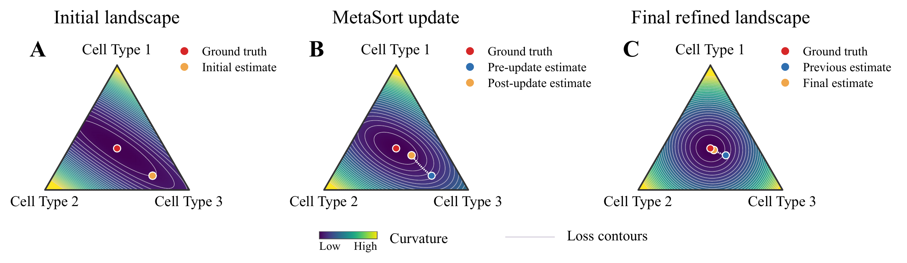
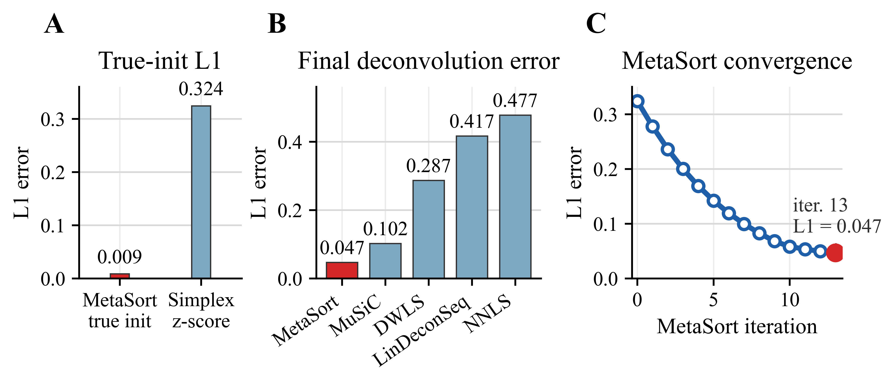
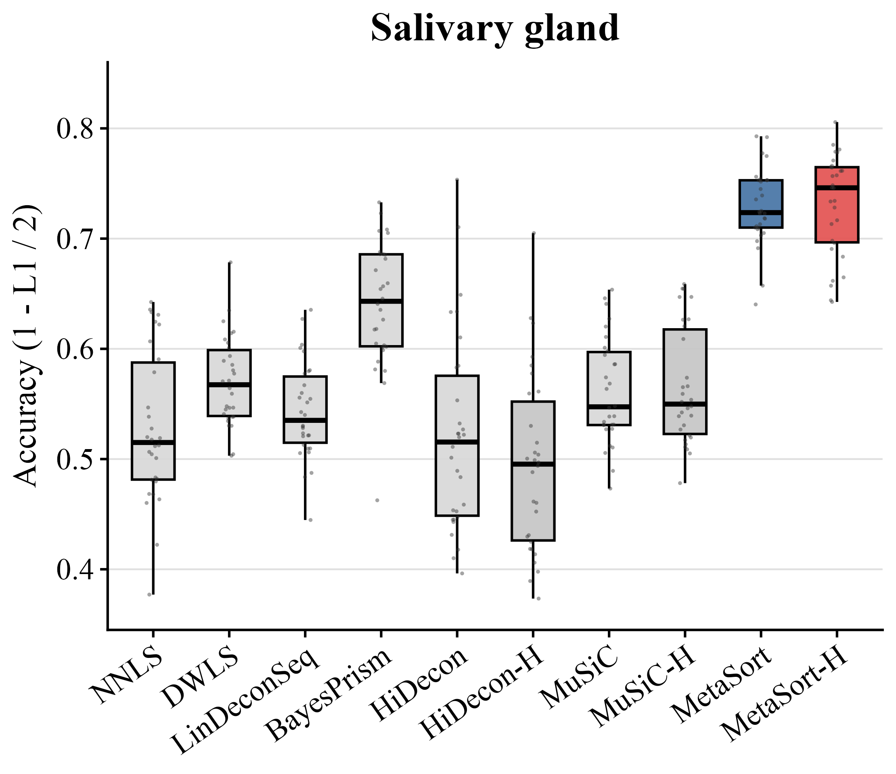
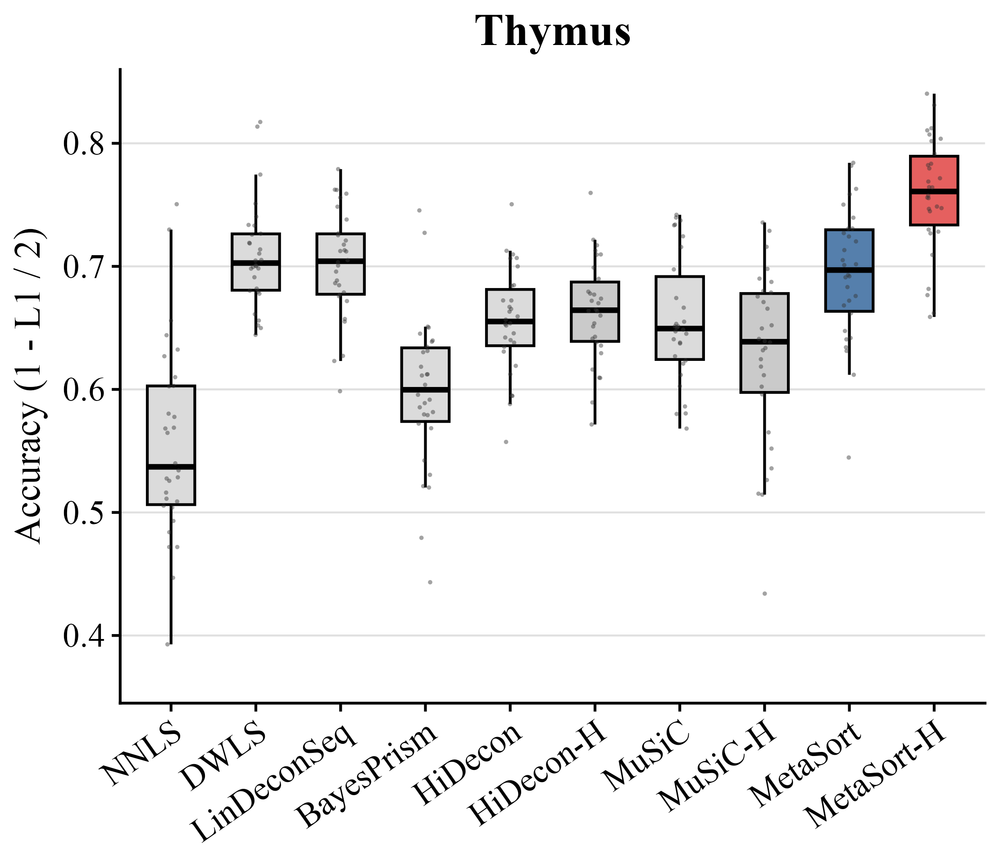
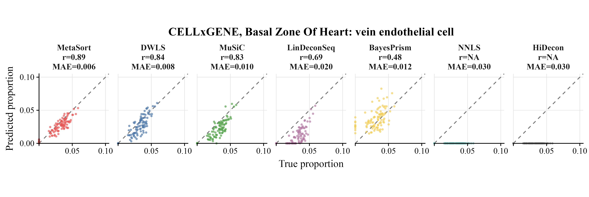
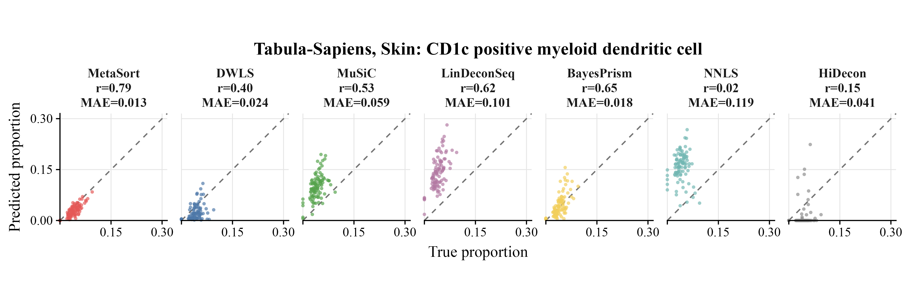
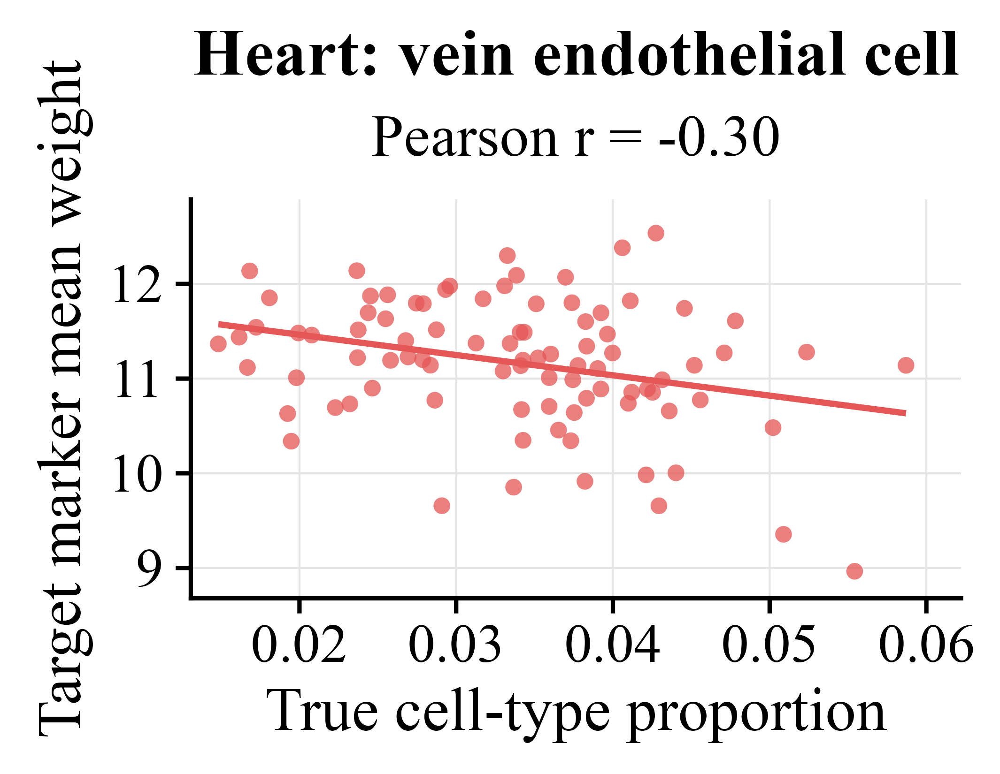
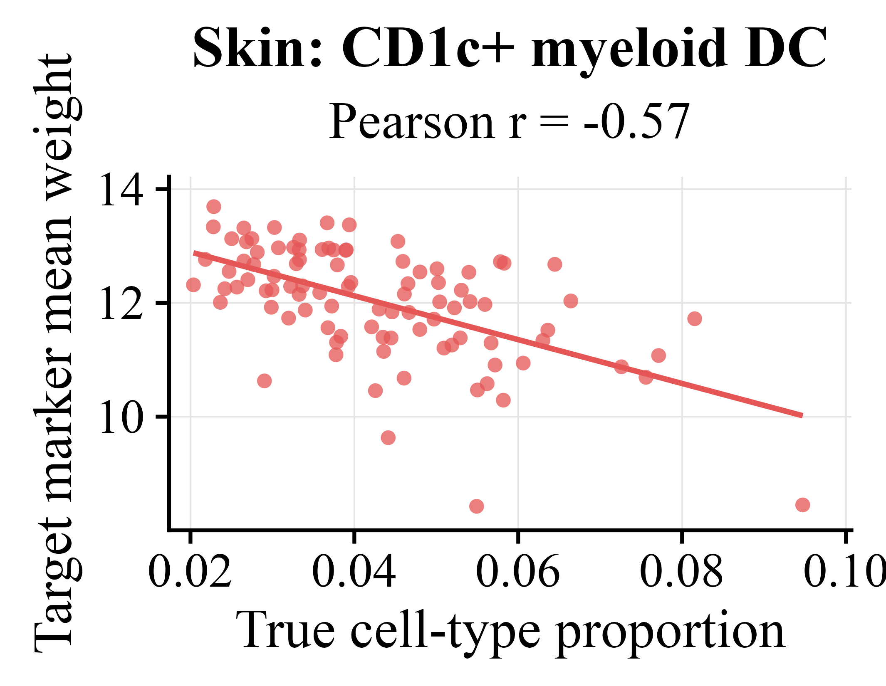
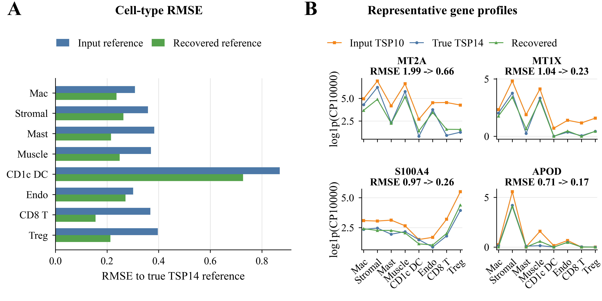

# MetaSort

**Robust and Versatile Bulk-RNA-seq Deconvolution Through Meta-Learning**

BIBM short paper · Code, selected benchmark data, and reproducible results

[Lab repository](https://github.com/gift-novellab/MetaSort) ·
[Repository linked in the paper](https://github.com/047kzy/metasort-bibm-2026)

[Quick start](#quick-start) · [Results](#results) · [Reproduce the figures](#reproduce-the-figures) · [Repository layout](#repository-layout)

## About the paper

Bulk RNA-seq measures gene expression across a mixture of cell types. Estimating
cell-type proportions from these measurements is challenging when reference
profiles overlap, cell types are rare, or reference and bulk samples come from
different donors.

MetaSort uses meta-learning to adapt gene weights during deconvolution. Starting
from a simplex-constrained least-squares estimate, it alternates between gene
weight optimization and updates of nonnegative cell-type proportions that sum
to one. The weighting objective incorporates local curvature and residual
information. The repository also implements hierarchy-aware deconvolution and
anchor-based recovery of bulk-domain reference profiles.

The experiments included here examine iterative optimization, hierarchical
cell-type composition, rare-cell-type estimation and marker weights, and
reference recovery under donor mismatch. The figures below show selected
retained experiments accompanying the paper.



**Figure 1. Adaptive Curvature Shaping Framework of MetaSort.**
(A) A directionally flat loss landscape can bias the estimated proportions away
from the ground truth. (B) MetaSort adaptively reshapes the loss landscape and
guides the estimate toward the ground truth. (C) The resulting well-conditioned
landscape yields the estimate closest to the ground truth.

[Download Figure 1 (PDF)](docs/figures/fig1.pdf)

## Quick start

### 1. Install dependencies

```bash
git clone https://github.com/gift-novellab/MetaSort.git
cd MetaSort
python -m venv .venv
source .venv/bin/activate
python -m pip install -r requirements.txt
```

The core solver uses NumPy, pandas, SciPy, and PyTorch. Matplotlib is used for
Python figures; AnnData is needed for workflows that read h5ad files. Run the
commands below from the repository root. This is a source release: import the
local `metasort` package rather than installing it from PyPI.

The hierarchy and rare-cell-type plots additionally require R. Their module
READMEs list the R packages and external baseline-method dependencies.

### 2. Estimate cell-type proportions

Run this example in Python from the repository root. It uses the included
Salivary Gland signature and the first bulk mixture, so no additional data
download is needed.

```python
from pathlib import Path

import pandas as pd

from metasort import MetaSortConfig, MetaSortSolver, load_bulk_signature_inputs

case_dir = Path("results/hierarchy/data/inputs/Salivary_Gland")
signature, bulk, genes, cell_types = load_bulk_signature_inputs(
    case_dir,
    mixture_name="Mixture1",
    signature_name="signature.tsv.gz",
    bulk_name="bulk.tsv.gz",
)

solver = MetaSortSolver(MetaSortConfig())
result = solver.solve(signature, bulk, cell_types=cell_types)

proportions = pd.Series(
    result.proportions, index=result.cell_types, name="Mixture1"
)
print(proportions)
print(f"Genes: {len(genes)}; iterations: {result.iterations}; converged: {result.converged}")
# Optional: proportions.to_csv("metasort_proportions.tsv", sep="\t")
```

The result contains the final and initial proportions, convergence status,
iteration count, and learned gene weights (`result.meta_weights`). This example
uses the solver defaults. For the paper's benchmark settings and complete
method reruns, use the module-specific scripts below.

### 3. Use your own data

Provide tab-separated expression tables with gene identifiers in the first
column and column names in the first row:

| Input | Rows | Columns |
| --- | --- | --- |
| `signature.txt` | Genes | Reference cell types |
| `bulk.txt` | Genes | Bulk samples or mixtures |

Use matching gene identifiers and compatible expression preprocessing for the
two inputs. Set `case_dir` to your data directory, `mixture_name` to a bulk
column name, and the two filenames to your input files. Plain TSV and gzipped
TSV inputs are supported by the loader.

`load_bulk_signature_inputs` selects shared genes, aligns the rows, normalizes
each signature column and the selected bulk vector to sum to one, then applies
a joint gene-wise z-score transformation. Inputs must contain shared genes and
have positive finite sums for normalization. The array-level `solver.solve`
interface expects a genes-by-cell-types matrix and a matching one-dimensional
bulk vector; it does not perform this preprocessing automatically.

To process multiple samples, load and solve each bulk column separately.
`MetaSortConfig` exposes iteration limits, convergence tolerance, averaging,
and gene-weight optimization settings; see [the implementation](metasort/metasort.py).

## Results

The images below are committed outputs, viewable without running the code.
They describe the selected experiments retained in this release, rather than
an exhaustive benchmark across every dataset.

### Iterative optimization and oracle initialization

The selected Tabula Sapiens Tongue `Mixture10` case compares an oracle
true-initialized update, final method errors, and the MetaSort iteration trace.
In the standard run shown in panel C, L1 error decreases from approximately
0.324 at initialization to 0.047 at iteration 13. Panel A uses known true
proportions as a diagnostic initialization; this is separate from the standard
inference run.



[Experiment details and source tables](results/oracle_experiment/README.md)

### Hierarchy-aware deconvolution

Salivary Gland and Thymus benchmarks compare ten baseline and hierarchy-aware
method variants across 30 mixtures per tissue. Accuracy is `1 - L1 / 2`
(higher is better); the `-H` suffix denotes a hierarchy-aware variant.

| Salivary Gland | Thymus |
| --- | --- |
|  |  |

[Experiment details](results/hierarchy/README.md) ·
[Retained accuracy and error summaries](results/hierarchy/data/outputs/all_methods_version2_summary.tsv)

### Rare-cell-type estimation and marker weights

The Heart example compares predicted and true vein endothelial cell proportions.
In this retained case, MetaSort has a reported correlation of 0.89 and MAE of
0.006. The dashed diagonal marks perfect agreement.



The module also includes a Skin CD1c-positive myeloid dendritic cell example
and analyses relating selected marker weights to true cell-type proportions.

<details>
<summary>Show the Skin result and marker-weight analyses</summary>







</details>

[Experiment details, retained inputs, and plotting workflow](results/rare_celltype/README.md)

### Reference recovery under donor mismatch

The Skin experiment uses a TSP10 input reference with TSP14 bulk mixtures.
Recovered reference profiles are compared with the true TSP14 reference using
cell-type RMSE and representative gene profiles. Expression is shown on the
`log1p(CP10000)` scale.



[Experiment details and retained reference matrices](results/reference_recovery/README.md)

## Reproduce the figures

These commands start from the retained inputs and outputs. Figure regeneration
can overwrite the corresponding committed figures and derived tables.

### Hierarchy benchmark

Requires R and `ggplot2`:

```bash
Rscript results/hierarchy/scripts/build_figure_metrics.R
Rscript results/hierarchy/scripts/plot_accuracy_boxplots.R
```

To rerun MetaSort before rebuilding the metrics and figures:

```bash
METASORT_JK_PATH=. python results/hierarchy/scripts/run_metasort.py
METASORT_JK_PATH=. python results/hierarchy/scripts/run_metasort_hierarchy.py
```

### Rare-cell-type analysis

Requires R packages `dplyr`, `ggplot2`, `readr`, and `scales`:

```bash
bash results/rare_celltype/reproduce_all.sh
```

### Tongue oracle-initialization case

```bash
python -m pip install -r results/oracle_experiment/requirements.txt
python results/oracle_experiment/scripts/validate_retained_data.py
python results/oracle_experiment/scripts/make_final_figure.py
```

### Bulk-reference recovery

```bash
python results/reference_recovery/scripts/generate_figure.py
```

The module READMEs document optional upstream experiment reruns and external
baseline packages. Some plots use Times New Roman and Cairo PDF output;
available fonts can affect the regenerated layout.

## Repository layout

```text
.
├── metasort/                  # Core solvers and input preprocessing
├── docs/figures/              # Paper overview figure (PDF and PNG)
├── requirements.txt           # Python dependencies
├── scripts/baselines/         # Shared baseline method runners
└── results/
    ├── hierarchy/             # Hierarchy-aware deconvolution benchmark
    ├── rare_celltype/         # Rare-cell-type and marker-weight analyses
    ├── oracle_experiment/     # Selected Tongue oracle-initialization case
    └── reference_recovery/    # Bulk-reference recovery experiment
```

Each result module includes a README describing its inputs, outputs,
dependencies, and rerun instructions. Shared external-method wrappers are
listed in [the baseline runner documentation](scripts/baselines/README.md).

## Data and reproducibility

This release contains selected benchmark inputs, predictions, and figure-source
tables. It does not include every upstream dataset or exploratory experiment.
The raw Skin h5ad required for the optional reference-recovery rerun is not
redistributed; see the [module README](results/reference_recovery/README.md).

Verify the retained files before regenerating results:

```bash
(cd results/rare_celltype && sha256sum -c MANIFEST.sha256)
(cd results/oracle_experiment && sha256sum -c SHA256SUMS)
```

External baseline methods require their own packages. Their archived runners
were not executed during release assembly. Python dependencies are currently
unpinned; numerical results may vary with dependency versions and platforms.

## Paper and citation

This repository accompanies the BIBM short paper
**Robust and Versatile Bulk-RNA-seq Deconvolution Through Meta-Learning**.
If you use MetaSort in your research, please cite the paper. Complete
bibliographic metadata and a paper link will be added when available.

## License

The project code is licensed under the [MIT License](LICENSE). Third-party
software and datasets remain subject to their respective licenses and terms.
